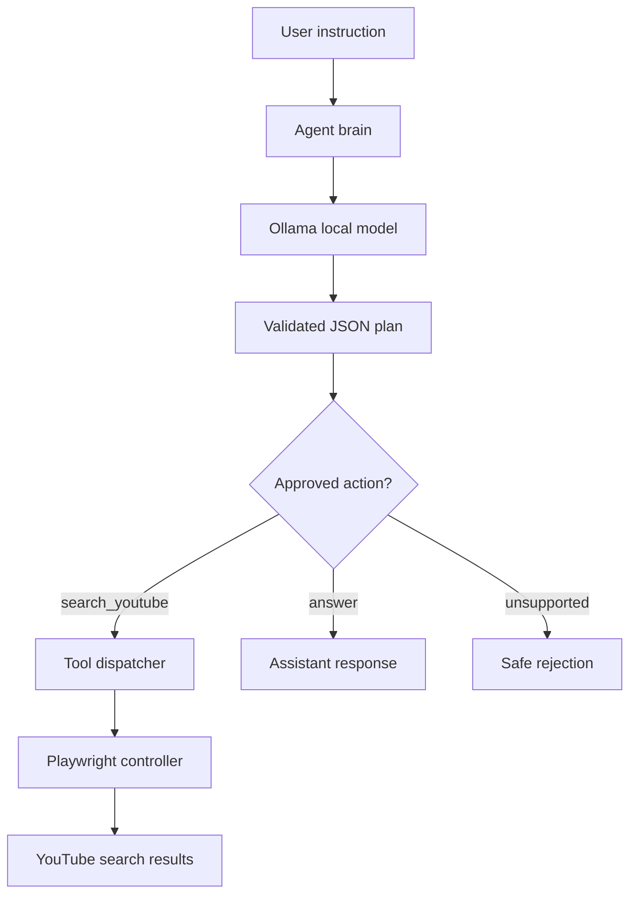

<div align="center">

# 🤖 Desktop AI Agent

**A local AI agent for natural-language browser automation.**

Interpret instructions, choose approved tools, and automate browser tasks with Python, Ollama, and Playwright.


</div>

---

## Overview

Desktop AI Agent is an experimental local-first assistant that turns natural-language requests into actions performed by a browser.

The first milestone focuses on a deliberately small and auditable capability set: the agent can interpret a request and search YouTube using a visible Chromium browser. The language model does **not** generate or execute Python or shell commands.

## Features

- Local inference through Ollama.
- Natural-language instructions in Portuguese or English.
- Structured action plans returned as JSON.
- Explicit allowlist of supported actions.
- Browser automation with Playwright.
- Unit tests for action-plan validation.

## Architecture



### Project structure

```text
desktop-ai-agent/
├── agent/
│   ├── brain.py          # LLM request and structured plan validation
│   └── tools.py          # Allowlisted tool dispatcher
├── browser/
│   └── controller.py     # Playwright browser operations
├── config/
│   └── settings.py       # Environment-based configuration
├── tests/
│   └── test_brain.py     # Plan validation tests
├── docs/
│   └── architecture.md   # Architecture notes
├── .github/workflows/
│   └── tests.yml         # Continuous integration
├── main.py               # CLI entry point
└── pyproject.toml
```

## Requirements

- Python 3.11 or newer
- [uv](https://docs.astral.sh/uv/)
- [Ollama](https://ollama.com/)
- A model available in Ollama (default: `qwen3.5:4b`)

## Getting started

### 1. Clone the repository

```bash
git clone https://github.com/YOUR_USERNAME/desktop-ai-agent.git
cd desktop-ai-agent
```

### 2. Install dependencies

```bash
uv sync --all-groups
uv run playwright install chromium
```

On Linux, if Chromium reports missing system libraries, run:

```bash
uv run playwright install --with-deps chromium
```

### 3. Start Ollama

Make sure the Ollama API is reachable at `http://127.0.0.1:11434`.

```bash
ollama pull qwen3.5:4b
```

If Ollama is running on the Windows host and the project runs inside WSL, configure `OLLAMA_BASE_URL` with the host address reachable from WSL.

### 4. Run the agent

```bash
uv run python main.py
```

Example instruction:

```text
Pesquise músicas eletrônicas no YouTube
```

The agent will validate the requested action, open Chromium, and display YouTube search results. Press Enter in the terminal to close the browser.

## Configuration

Configuration is read from environment variables:

| Variable | Default | Description |
|---|---|---|
| `OLLAMA_BASE_URL` | `http://127.0.0.1:11434` | Ollama API base URL |
| `OLLAMA_MODEL` | `qwen3.5:4b` | Local model name |
| `BROWSER_HEADLESS` | `false` | Run Chromium without a visible window |

Example:

```bash
export OLLAMA_MODEL="qwen3.5:4b"
export OLLAMA_BASE_URL="http://127.0.0.1:11434"
```

## Development

Run tests:

```bash
uv run pytest
```

Run lint checks:

```bash
uv run ruff check .
```

Format code:

```bash
uv run ruff format .
```

## Safety design

- The model can only request actions from a fixed allowlist.
- Tool arguments are validated before execution.
- No model-generated shell commands or Python code are executed.
- Browser automation is limited to the explicitly implemented operations.
- Review any future tool before adding it to the dispatcher.

This is an educational project. Do not connect it to sensitive accounts or unattended workflows without adding authentication, permission checks, logging, and human approval.

## Roadmap

- [x] Local Ollama connection
- [x] Structured action planning
- [x] Allowlisted tool execution
- [x] YouTube browser search
- [ ] Conversation memory
- [ ] LangGraph workflow orchestration
- [ ] Voice input and speech output
- [ ] FastAPI service
- [ ] Multi-agent coordination
- [ ] Browser task history and observability

## Contributing

Issues and pull requests are welcome. For substantial changes, open an issue first to discuss the proposed design.

## License

Distributed under the MIT License. See `LICENSE`.
