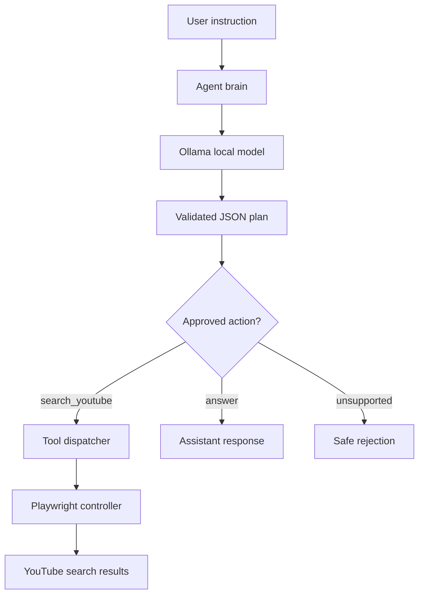

<div align="center">

# 🤖 Desktop AI Agent

**A local AI agent for natural-language browser automation.**

Interpret instructions, choose approved tools, and automate browser tasks with Python, Ollama, and Playwright.


</div>

---

## Overview

Desktop AI Agent is a local-first Python application that turns an image of a
song list into a reviewed, ordered YouTube playback queue. The user approves
the recognized tracks, selects a video for each track, and confirms the queue
before playback. The language model does **not** generate or execute Python or
shell commands.

## Features

- Local inference through Ollama.
- Natural-language instructions in Portuguese or English.
- Structured action plans returned as JSON.
- Explicit allowlist of supported actions.
- Browser automation with Playwright.
- Ordered image recognition and manual review.
- Explicit YouTube candidate selection for each track.
- Browser-independent queue with per-track states.
- Automatic ordered playback through YouTube's IFrame Player API.
- Per-track playback state and failed-embed reporting.
- Unit tests for parsing, queue state, selection, and playback fallbacks.

## Architecture



### Project structure

```text
desktop-ai-agent/
├── agent/
│   ├── brain.py          # Ollama vision, planning, and response validation
│   └── tools.py          # Tool and playback dispatch
├── music/
│   ├── models.py         # Track, video candidate, and queue status models
│   └── queue.py          # Ordered queue state, independent of Playwright
├── browser/
│   └── controller.py     # YouTube search and confirmed URL playback
├── config/
│   └── settings.py       # Environment-based configuration
├── tests/                # Parsing, selection, queue, and browser tests
├── docs/
│   ├── architecture.md   # Architecture notes
│   └── whatsapp-image-intake.md # Initial WhatsApp integration research
├── .github/workflows/
│   └── tests.yml         # Continuous integration
├── main.py               # CLI entry point
└── pyproject.toml
```

## Requirements

- Python 3.11 or newer
- [uv](https://docs.astral.sh/uv/)
- [Ollama](https://ollama.com/)
- A model available in Ollama (default: `qwen3.5:4b`)

## Getting started

### 1. Clone the repository

```bash
git clone https://github.com/YOUR_USERNAME/desktop-ai-agent.git
cd desktop-ai-agent
```

### 2. Install dependencies

```bash
uv sync --all-groups
uv run playwright install chrome
```

Playwright installs a managed Google Chrome build. On Linux/WSL, if Chrome
reports missing system libraries, run:

```bash
uv run playwright install --with-deps chrome
```

### 3. Start Ollama

Make sure the Ollama API is reachable at `http://127.0.0.1:11434`.

```bash
ollama pull qwen3.5:4b
```

If Ollama is running on the Windows host and the project runs inside WSL, configure `OLLAMA_BASE_URL` with the host address reachable from WSL.

### 4. Run the agent

```bash
uv run python main.py
```

Example instruction:

```text
Pesquise músicas eletrônicas no YouTube
```

To read a song list from an image and play the songs in order, enter:

```text
/imagem /caminho/para/lista.png
```

You can also type `/imagem` and provide the path when prompted. The configured
Ollama model must support image input. The agent shows the recognized songs in
visual order and asks you to confirm or edit each item before starting any
search. Items the model could not read are marked as ambiguous and must be
resolved or the flow cancelled. After confirmation, YouTube candidates are
listed for each song. Choose a candidate explicitly or enter `p` to leave that
song pending. This prompt repeats for each track; choosing a number only saves
that track's video and moves to the next search. After all tracks, review the
queue and type `s` at the final prompt to start. A local player page opens in
your normal browser with the selected videos loaded through YouTube's supported
IFrame Player API. Click **Iniciar reprodução** once; the player then advances
through the queue and reports completion/errors to the CLI. Use YouTube's own
controls to pause or resume, or click **Parar fila** to stop.

To process the newest image you saved from WhatsApp or another app into the
inbox folder, use `/imagem-recente`. The agent shows the selected filename and
time and asks you to confirm before reading it. Set `IMAGE_INBOX` to point at a
different folder, such as a Windows Downloads directory mounted under `/mnt/c`.

To import a public YouTube playlist, enter `/playlist` followed by its link:

```text
/playlist https://www.youtube.com/playlist?list=PLAYLIST_ID
```

The agent displays the videos in the order shown by YouTube and asks before
opening the queue. Private playlists and unavailable videos may not be
accessible. To try image inbox intake, copy an image into `images/`, run
`/imagem-recente`, check the displayed filename, and press Enter to confirm.

Some videos do not allow embedded playback. The player reports those as failed
and advances; open that candidate's regular YouTube page manually if needed.
The app does not extract media streams, bypass ads, or work around YouTube's
embed restrictions.

`/login_youtube` opens the regular YouTube page in your system browser if you
need to sign in manually. The embedded player can still reject videos that
require a top-level YouTube session.

## WhatsApp image intake research

The initial feasibility analysis for selecting the newest image from a
WhatsApp Web group is in [`docs/whatsapp-image-intake.md`](docs/whatsapp-image-intake.md).
An unpacked local Chrome extension prototype is in
[`extensions/whatsapp-image-picker`](extensions/whatsapp-image-picker), with
setup instructions in
[`docs/chrome-whatsapp-extension.md`](docs/chrome-whatsapp-extension.md). It
shows loaded image previews from the active WhatsApp conversation and downloads
only the image you confirm. Configure Chrome's download folder as `IMAGE_INBOX`,
then run `/imagem-recente` in the agent. The extension does not scan all chat
history or automatically start image recognition.

## Configuration

Configuration is read from environment variables:

| Variable | Default | Description |
|---|---|---|
| `OLLAMA_BASE_URL` | `http://127.0.0.1:11434` | Ollama API base URL |
| `OLLAMA_MODEL` | `qwen3.5:4b` | Local model name |
| `BROWSER_HEADLESS` | `false` | Run Chromium without a visible window |
| `BROWSER_CHANNEL` | `chrome` | Playwright browser channel; set empty to use bundled Chromium |
| `IMAGE_INBOX` | `images` | Folder searched by `/imagem-recente` |

Image recognition requires a vision-capable Ollama model. Images are sent only
to the configured Ollama endpoint. `BROWSER_HEADLESS` and `BROWSER_CHANNEL`
control the isolated browser used to search YouTube candidates; playback opens
in the normal system browser. On WSL, Windows' default browser is used. Set an
inbox folder from WSL with, for example, `export IMAGE_INBOX="/mnt/c/Users/you/Downloads"`.

Example:

```bash
export OLLAMA_MODEL="qwen3.5:4b"
export OLLAMA_BASE_URL="http://127.0.0.1:11434"
```

## Development

Run tests:

```bash
uv run pytest
```

Run lint checks:

```bash
uv run ruff check .
```

Format code:

```bash
uv run ruff format .
```

## Safety design

- The model can only request actions from a fixed allowlist.
- Tool arguments are validated before execution.
- No model-generated shell commands or Python code are executed.
- Browser automation is limited to the explicitly implemented operations.
- Review any future tool before adding it to the dispatcher.

This is an educational project. Do not connect it to sensitive accounts or unattended workflows without adding authentication, permission checks, logging, and human approval.

## Roadmap

- [x] Local Ollama connection
- [x] Structured action planning
- [x] Allowlisted tool execution
- [x] Ordered image recognition and manual review
- [x] Candidate selection and independent queue
- [x] Sequential playback of selected URLs
- [ ] Conversation memory
- [ ] LangGraph workflow orchestration
- [ ] Voice input and speech output
- [ ] FastAPI service
- [ ] Multi-agent coordination
- [ ] Browser task history and observability

## Contributing

Issues and pull requests are welcome. For substantial changes, open an issue first to discuss the proposed design.

## License

Distributed under the MIT License. See `LICENSE`.
